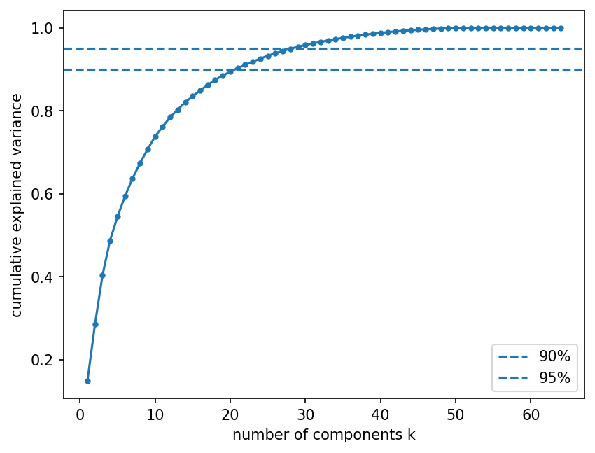
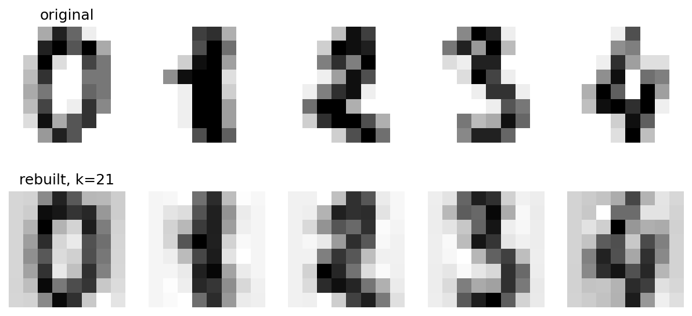
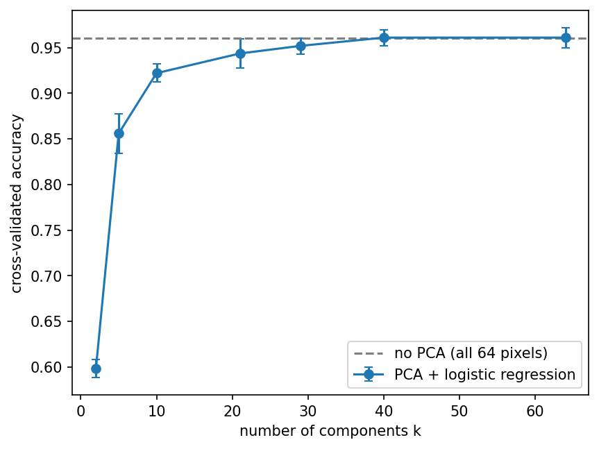

# PCA from Scratch on Handwritten Digits

I implemented Principal Component Analysis (PCA) with NumPy, checked it against scikit-learn, and tested how many components are needed before a classifier loses accuracy.

**Question:** the digits dataset has 64 features per image. How many can I drop with PCA without hurting a classifier?

## Data

`sklearn.datasets.load_digits`: 1797 images of handwritten digits (8×8 pixels = 64 features, 10 classes). Split: 80% train (1437) / 20% test (360), stratified, `random_state=0`.

## What I built

`src/pca.py` contains a `PCA` class with `fit`, `transform`, `fit_transform` and `inverse_transform`:

1. Center the data (the mean is learned in `fit` and reused in `transform`).
2. Compute the covariance matrix (divided by m − 1).
3. Find its eigenvalues and eigenvectors with `np.linalg.eigh`.
4. Sort from largest to smallest eigenvalue and keep the top k eigenvectors.
5. Project: `Y = (X − mean) @ components`.

**Check against scikit-learn:** on all 1797 digits with k = 10, my eigenvalues, variance ratios, projected data and components match `sklearn.decomposition.PCA` (`np.allclose`; components compared up to sign, because an eigenvector and its negative describe the same direction).

## Results

### How many components keep how much variance?
Each added component adds more variance, but the eigenvalues are sorted from largest to smallest, so the last components add very little information. 21 components keep 90% of the variance, and 29 keep 95%.




### What the compression looks like

Rebuilt digits with k = 21 (second row) are still easy to read. They are a little blurrier than the originals (first row).



### Accuracy with and without PCA

Logistic regression on the PCA features, 5-fold stratified cross-validation on the training set. PCA is fitted inside each fold on the training part only, so no information from the validation part leaks into it.

| Features | Mean accuracy | Std |
|---|---|---|
| All 64 pixels (no PCA) | 0.960 | 0.010 |
| k = 2 | 0.598 | 0.010 |
| k = 5 | 0.856 | 0.021 |
| k = 10 | 0.922 | 0.010 |
| k = 21 | 0.944 | 0.016 |
| k = 29 | 0.952 | 0.009 |
| k = 40 | 0.961 | 0.009 |
| k = 64 | 0.961 | 0.011 |



I chose **k = 29**, the smallest k whose mean accuracy is within one standard deviation of the no-PCA baseline (k = 21 is clearly below it). It also keeps 95% of the variance.

**Final check on the test set:** no PCA scores 0.958 and k = 29 scores 0.953. The gap is about 2 images out of 360, which is within noise.

## Conclusion

On this dataset, 29 PCA components (instead of 64 pixels) give nearly the same accuracy as using all pixels: about 0.8 points lower in cross-validation (within one standard deviation) and 0.5 points lower on the test set. PCA did **not improve** accuracy. It kept almost the same accuracy with fewer than half of the features.

## Limitations

- Small and easy dataset (8×8 images). A logistic regression is already fast on 64 features, so the practical gain here is small. PCA matters more with hundreds or thousands of features.
- The test set has 360 images, so one image is about 0.28% accuracy. Differences of one point are within noise.
- The pixels were not standardized, and I only tested one classifier (logistic regression).
- PCA is linear and ignores the labels, so high variance does not always mean useful for the prediction. Here the two agree, but that is not guaranteed on other data.

## Project structure

```
pca-from-scratch/
├── README.md
├── notebooks/analysis.ipynb
├── src/pca.py
└── images/
```

## How to run

```
pip install numpy scikit-learn matplotlib jupyter
jupyter notebook notebooks/analysis.ipynb
```

Run the notebook from inside the `notebooks` folder, because it imports `src/pca.py` with a relative path.